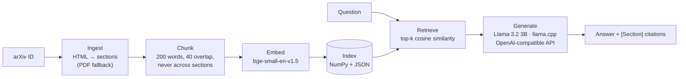

# Paper Companion

**Ask questions about any arXiv paper and get answers grounded in the paper's own text, with a citation to the section each answer came from. It runs fully locally on my 8 GB MacBook Air with Llama 3.2 3B.**


-orange)


I'm building this to learn the modern LLM stack hands-on: **RAG, Hugging Face transformers, llama.cpp, vLLM, SGLang, LangChain/LangGraph, evaluation, Docker and Kubernetes**. Each part of the app gives me a reason to learn one technology properly. The core pipeline is written **from scratch first**, without frameworks, so I understand every layer before swapping in a framework and measuring the difference.

---

## What works today

```text
Paper:    1706.03762 ("Attention Is All You Need")
Question: How many layers does the encoder have?
Answer:   N = 6 … [3 Model Architecture]

Question: (something the paper doesn't cover)
Answer:   I do not know.
```
*Real outputs from the local pipeline, abbreviated.*

- **Ingestion:** fetches a paper by arXiv ID, parses the HTML version into clean sections, and falls back to the PDF when no HTML exists.
- **Retrieval:** splits sections into chunks, embeds them, and finds the passages closest in meaning to the question.
- **Grounded generation:** a local Llama 3.2 3B (4-bit, via llama.cpp) answers **only from the retrieved text**, cites the section, and says "I do not know" instead of guessing.

## How it works



| Stage | Code | What it does |
|---|---|---|
| Ingest | [`ingest/arxiv.py`](src/paper_companion/ingest/arxiv.py) | arXiv HTML → sections with BeautifulSoup; strips figures, keeps each formula once as LaTeX; PyMuPDF page-level fallback |
| Index | [`index/vectors.py`](src/paper_companion/index/vectors.py) | Section-aware chunking; `sentence-transformers` embeddings; saves vectors and chunks per paper |
| Retrieve | [`retrieve/search.py`](src/paper_companion/retrieve/search.py) | Dot product over normalized vectors (cosine similarity), with the model's query-instruction prefix |
| Generate | [`generate/answer.py`](src/paper_companion/generate/answer.py) | Builds a grounded prompt and calls any OpenAI-compatible server through `LLM_URL` |

## What I've measured so far

- **Generation speed on the M1:** about 80–95 tokens/s reading the prompt and 10–13 tokens/s writing, with llama.cpp reusing cached prompt prefixes.
- **The query prefix matters:** on a test question, bge's query instruction moved the correct passage from rank 3 to rank 1. This is a single example, and Step 5 replaces anecdotes like it with benchmark scores.
- **Grounding works both ways:** without context the model refuses ("unable to verify"); with retrieved context it answers and cites correctly, and it says "I do not know" for out-of-scope questions.

## Roadmap

v1 is done when the pipeline has a **measured score on a QASPER subset** (a benchmark of questions about NLP papers).

| # | Step | Technologies | Status |
|---|---|---|---|
| 0 | Project skeleton | uv, git | ✅ |
| 1 | Tokens, logits and generation by hand | Hugging Face transformers, PyTorch | ✅ |
| 2 | Fetch an arXiv paper and split it by section | httpx, BeautifulSoup, PyMuPDF | ✅ |
| 3 | Chunk, embed and search, without frameworks | sentence-transformers, NumPy | ✅ |
| 4 | Answer with citations from a local LLM | llama.cpp, Llama 3.2 3B | ✅ |
| 5 | **Evaluation v1 on QASPER** (v1 milestone) | HF datasets, retrieval and answer metrics | 🔄 in progress |
| 6 | Better retrieval: chunking, keyword + vector hybrid, reranker | BM25, cross-encoders | ⬜ |
| 7 | PDF parser comparison, scored against arXiv HTML | PDF parsers | ⬜ |
| 8 | Rebuild the pipeline in LangChain and compare | LangChain | ⬜ |
| 9 | Paper summary cards with structured JSON output | vLLM, constrained decoding | ⬜ |
| 10 | Serving benchmarks: throughput, KV cache, prefix caching | transformers vs vLLM vs SGLang | ⬜ |
| 11 | Answer → verify → retry agent loop | LangGraph | ⬜ |
| 12 | Multi-paper comparison tables, scored on ArxivDIGESTables | Synthesis, evaluation | ⬜ |
| 13 | Related-paper discovery | Semantic Scholar API, SPECTER2 | ⬜ |
| 14 | Containerize the services | Docker | ⬜ |
| 15 | Run on a local cluster | Kubernetes | ⬜ |
| 16 | Optional: fine-tune an embedding model | transformers | ⬜ |

The full plan, hardware constraints and reasoning are in the [design doc](docs/design.md).

## Run it locally

Requirements: Python 3.12+, [uv](https://docs.astral.sh/uv/), and [llama.cpp](https://github.com/ggml-org/llama.cpp) (`brew install llama.cpp` on macOS).

```bash
git clone https://github.com/Ibraheem325/paper-companion.git
cd paper-companion
uv sync

# Terminal 1: start the local LLM (downloads about 2 GB the first time)
llama-server -hf bartowski/Llama-3.2-3B-Instruct-GGUF:Q4_K_M -c 4096 --port 8080
```

```python
# Terminal 2: uv run python
from paper_companion.ingest.arxiv import fetch_paper
from paper_companion.index.vectors import build_index, save_index
from paper_companion.generate.answer import answer

paper = fetch_paper("1706.03762")                 # Attention Is All You Need
save_index(paper["arxiv_id"], *build_index(paper))

text, sources = answer("How many layers does the encoder have?", "1706.03762")
print(text)
```

To use a different engine, point `LLM_URL` at any OpenAI-compatible chat endpoint.

## Repository layout

```
paper-companion/
├── src/paper_companion/
│   ├── ingest/      # arXiv HTML/PDF → clean sections
│   ├── index/       # chunking, embeddings, save/load
│   ├── retrieve/    # similarity search
│   └── generate/    # grounded prompting + LLM client
├── notebooks/       # one notebook per step: experiments before code moves into src/
├── docs/design.md   # goals, decisions, build order
└── harness/         # my AI tutor setup for this project (see below)
```

## How I work on it

- **Notebook first, then module.** Each step starts as an experiment in [`notebooks/`](notebooks), and only the parts that hold up move into `src/`.
- **Decisions are written down.** Each choice is logged with its reason and the alternatives (see [Engineering decisions](#engineering-decisions)).
- **An AI tutor built for this repo.** [`harness/`](harness) configures Claude Code as a project tutor: rules, project notes, two custom skills, and a local dashboard with a chat. It explains concepts, reviews my code against the design doc, and tracks progress, but leaves the code to me. See the [harness README](harness/README.md).

## License

[MIT](LICENSE)
